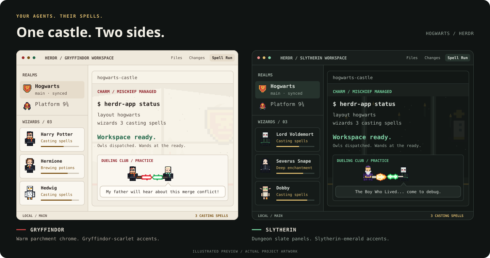
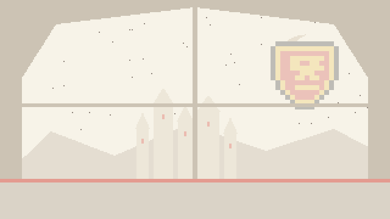
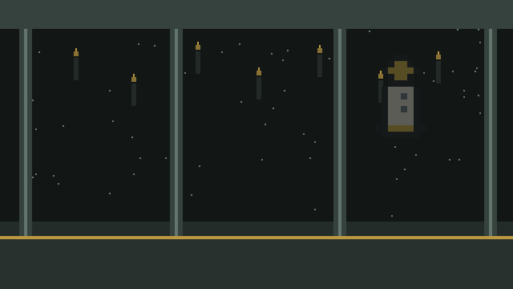
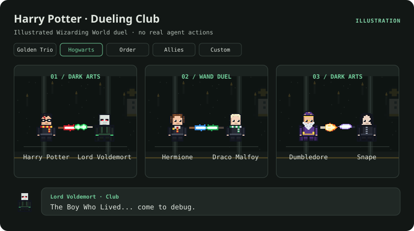
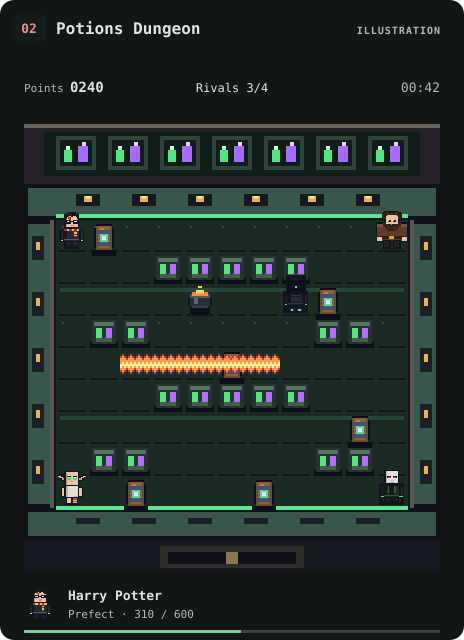
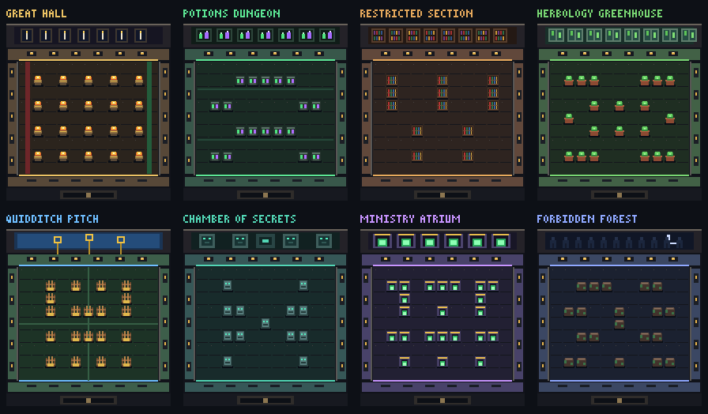

<h1 align="center">Harry Potter for Herdr</h1>

<p align="center">
  <strong>A Hogwarts command center for your coding agents.</strong><br>
  Pixel-art Harry Potter characters, Wizarding World backdrops, Dueling Club and Spell Run — inside <a href="https://herdr.dev">Herdr</a>.
</p>

<p align="center">
  <a href="#install">Install</a> ·
  <a href="#choose-your-house">Choose your side</a> ·
  <a href="#the-cast">Meet the cast</a> ·
  <a href="#dueling-club">Dueling Club</a> ·
  <a href="#spell-run">Spell Run</a> ·
  <a href="#customize-and-test">Customize</a> ·
  <a href="RECIPE.md">Recipe</a>
</p>

<p align="center">
  
  
  
</p>

<p align="center">
  
  <br>
  <sub>Illustrated overview using the actual project artwork and theme colors. Not a screenshot.</sub>
</p>

Your agents become the Wizarding World cast. Your spaces become iconic Hogwarts & Wizarding locations. Keep real coding work in view, with a little more magic around it.

| Track your wizards | Explore the castle | Duel between tasks |
| --- | --- | --- |
| Character cards, live statuses, model and context details, pinning and sub-agent trees. | Seven Wizarding World locations, matching scenic backdrops, Git branch and upstream status. | Multi-front wand duels, custom squads and iconic Harry Potter banter in the Dueling Club. |

## Install

You need the [Herdr desktop app](https://herdr.dev) installed, with `herdr-app` available in your shell. From the repository root, run:

```sh
sh ./install.sh
```

The installer backs up replaced Hogwarts files under `backups/hogwarts-<timestamp>/`, validates all seven custom mods, then tries to select the layout. It leaves unrelated layouts (including `doomsday` or `star-wars`), mods and settings completely untouched. The default destination is `~/.config/herdr-app`; set `HERDR_APP_HOME` to use another app home.

To return to another workspace appearance, switch layouts in Herdr. Keep Herdr's built-in mods installed: this layout uses `workspace-chrome`, `pane`, `files` and `changes`. The top bar is `hogwarts-tabs`, a copy of Herdr's `tabs` with a **Spell Run** button added.

## Choose your house

One layout, two coordinated Wizarding appearances:

| Gryffindor (Light) | Slytherin (Dark) |
| --- | --- |
| Warm parchment surfaces, scarlet accents and sunlit castle views. | Dungeon slate surfaces, silver-emerald accents and moonlit vistas. |
| 14 available Hogwarts characters & Dementors. | The same roster, with Lord Voldemort joining the cast. |

The layout follows system appearance until you select a side. Use **Harry Potter: Gryffindor (Light)** or **Harry Potter: Slytherin (Dark)** in the command palette, or run:

```sh
herdr-app do hogwarts-systems.light
herdr-app do hogwarts-systems.dark
```

<details>
<summary>Explore the Wizarding World backdrops</summary>

<table>
  <tr>
    <th>Gryffindor · Gryffindor Tower</th>
    <th>Slytherin · Great Hall</th>
  </tr>
  <tr>
    <td></td>
    <td></td>
  </tr>
</table>

Every location has both appearances: **Great Hall, Hogwarts Express, Gryffindor Tower, Slytherin Dungeon, Quidditch Pitch, Diagon Alley** and **Astronomy Tower**. Each space keeps a stable location identity; its backdrop follows that space and the active appearance.

</details>

## The cast

<p align="center">
  
  
  
  
  
  
  
  
  
  
  
  
  
  
  
</p>

Harry Potter, Hermione Granger, Ron Weasley, Albus Dumbledore, Severus Snape, Rubeus Hagrid, Prof. McGonagall, Sirius Black, Draco Malfoy, Luna Lovegood, Bellatrix Lestrange, Dobby, Hedwig and Dementor are available in both appearances. Lord Voldemort joins on Slytherin (dark).

Characters stay unique across agents; extra agents receive Dementors after the other available characters are assigned.

| Agent status | In your workspace |
| --- | --- |
| **Working** | Casting spells. Long-running work progresses through **Brewing potions**, **Deep enchantment** and **Battle of Hogwarts**. |
| **Blocked** | Needs backup, with a visible `!` indicator. |
| **Done** | Mischief managed, with a completion marker. |
| **Idle** | In common room. |

### Mini duels

Two or more agents in the same space appear over that space's Wizarding backdrop. Working wizards cast spells, blocked wizards hold position, and done wizards celebrate. Dialogue alternates between speakers, with pair-specific Harry Potter quotes and status-aware lines.

## Dueling Club

A separate practice scene, with no commands sent to real agents.

1. **Build a matchup.** Choose **Golden Trio**, **Hogwarts**, **Order** or **Allies**, or pick **Custom** and select 2–8 wizards from the full cast. Selection order defines pairs; an odd wizard stays on standby.
2. **Follow the spells.** Up to four duels run at once, with Harry's *Expelliarmus*, Voldemort's *Avada Kedavra*, Dumbledore's *Phoenix Flame*, Snape's *Sectumsempra*, Sirius's *Expecto Patronum*, Hagrid's pink umbrella, Luna's Spectrespecs charms, Bellatrix's twin *Crucio* hexes and Dobby's house-elf snap. Hedwig stays unarmed on owl-post support.
3. **Tune the conversation.** Click a wizard to hear that duel; click again to return to club comms. Use **Next line** or **Replay** to step through the banter.
4. **Set the pace.** Choose **0.5× / 1× / 2×**, **Pause / Resume**, or **Motion: reduced**. Close with **Close** or Escape.

Open **Harry Potter: Dueling Club** from the command palette, use **Expand** in a mini duel, or run:

```sh
herdr-app do mod.open --name hogwarts-arena
```

<details>
<summary>See the Dueling Club</summary>

<p align="center">
  
  <br>
  <sub>Illustration built from the project artwork. Not a screenshot.</sub>
</p>

</details>

## Spell Run

A Bomberman-style Wizarding arcade game. Open it from the command palette or from the **Spell Run** button in the top bar, next to Files and Changes. Run **Harry Potter: Toggle Spell Run** from the command palette to hide or restore the button. To open it directly:

```sh
herdr-app do mod.open --name hogwarts-spell-run
```

Plant bubbling **Exploding Cauldrons** with **Space**, move with **WASD / arrow keys**, pause with **P / Escape**, restart with **R**, cast facing volleys with **Q**, and cycle special spells (**Standard / Fiendfyre / Time-Turner Echo**) with **E**.

**Characters stay unique, including your wizard.** Only Dementors can repeat. Eight iconic Wizarding World rooms each have their own solid-wall maps, props, palettes and pixel-art architecture: **Great Hall, Potions Dungeon, Restricted Section, Herbology Greenhouse, Quidditch Pitch, Chamber of Secrets, Ministry Atrium and Forbidden Forest**.

| Charm upgrade | Requires | Effect |
| --- | --- | --- |
| **Engorgio blast** | Room 2 + 200 XP | 3-tile reach; 4 at room 5 + 1,200 XP, 5 at room 8 + 2,200 XP |
| **Extra cauldron** | Room 3 + 600 XP | 2 active cauldrons; 3 at room 8 + 2,200 XP |
| **Spell volley** | Room 5 + 900 XP | **Q / Volley** plants a facing row using available cauldrons |
| **Fiendfyre wave** | Room 6 + 1,400 XP | Optional three-tile-wide blast lanes |
| **Firebolt dash** | Room 7 + 1,800 XP | One speed upgrade: 160 → 120 ms per tile (1.33×) |
| **Time-Turner echo** | Room 8 + 2,400 XP | Optional second blast after one second, marked by warning beacons |

**Optional: Thinking only.** Toggle the link icon to play only while the selected wizard's agent reports `working`.

<details>
<summary>See Spell Run</summary>

<p align="center">
  
  <br>
  <sub>Illustration built from the game's own pixel art. Not a screenshot.</sub>
</p>

</details>

<details>
<summary>Explore all eight Hogwarts room layouts</summary>



Generated artwork and fixed wall layouts, not an app screenshot. Enchanted barrels and characters are omitted so each room’s architecture is visible.

</details>

## Customize and test

| Change | Edit |
| --- | --- |
| Interface colors and backdrop palettes | `themes/gryffindor.json`, `themes/slytherin.json` |
| Character pixels, palettes and spells | `tools/build-sprites.py` |
| Wizarding location emblems and backdrops | `tools/build-realm-backgrounds.py` |
| Dueling Club presets, profiles and banter | `mods/hogwarts-arena/choreography.js` |
| Spell Run rooms and wall maps | `mods/hogwarts-spell-run/decks.js` |
| Spell Run room art, props and walking atlases | `tools/build-spell-run-art.py` |
| Mini-duel dialogue and presentation | `mods/hogwarts-agents/battle.js` |
| README illustrations, `layouts/hogwarts.svg` and `preview.png` | `tools/build-readme-art.py` |

Rebuild artwork after changing its source:

```sh
python3 tools/build-sprites.py --preview /tmp/hp-sprites.png
python3 tools/build-realm-backgrounds.py --preview /tmp/hp-realms.png
python3 tools/build-spell-run-art.py --preview docs/images/spell-run-decks.png
python3 tools/build-readme-art.py
```

Run the regression suite with Node's built-in test runner:

```sh
node --test tools/*.test.mjs
```

Validate changed mods with `herdr-app check mods/<mod-name>` as well. For the implementation map, see [Architecture](docs/architecture.md).

## Herdr gallery

This repository is a [Herdr community layout](https://herdr.dev/layouts): the root holds `layouts/hogwarts.json`, its `mods/`, the [`RECIPE.md`](RECIPE.md) brief and `preview.png`, and the repo carries the `herdr-layout` topic.

---

Fan-made pixel-art tribute project for Herdr. Not affiliated with or endorsed by J.K. Rowling, Wizarding World or Warner Bros.
