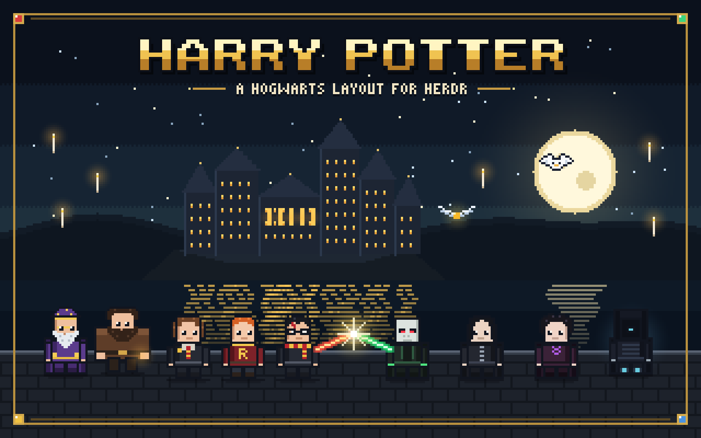

# Harry Potter for Herdr

A two-theme Wizarding World Herdr layout with a Hogwarts locations & Git sidebar, a character-based wizard agent board, status bar, owl-post notifications, an animated Dueling Club overlay, and a Bomberman-style Spell Run arcade panel.

## What you see

The layout is a full-height window split into a sidebar and work area. The preview is an illustration, not a screenshot: it shows the Gryffindor (light parchment) and Slytherin (dark dungeon) palettes side by side, built from the project's own pixel artwork.

- **Left sidebar — 268 px by default; 44–480 px range.** Top `workspace-chrome` brand block (46 px), **Realms** (`hogwarts-systems`) and **Wizards** (`hogwarts-agents`) sharing the height equally (90 px min each), and the 69 px `workspace-chrome` footer.
- **Realms — upper sidebar list.** Each space receives a stable Wizarding World location emblem and name (*Great Hall, Hogwarts Express, Gryffindor Tower, Slytherin Dungeon, Quidditch Pitch, Diagon Alley, Astronomy Tower*) plus read-only Git branch/upstream status.
- **Wizards — lower sidebar list.** Agent cards show their Harry Potter character, status, model and context use when detected. Mini duels appear for spaces with multiple agents.
- **Work area — remaining width.** The `hogwarts-tabs` bar (42 px) holds tab pills, `+`, **Files**, **Changes** and **Spell Run** panel buttons.
- **Status bar — 28 px at the bottom.** Shows the active machine, branch and Wizarding status counts.

| Role | Gryffindor (Light) | Slytherin (Dark) |
| --- | --- | --- |
| Background / foreground | `#f7f3e8` / `#261f1c` | `#121715` / `#e0e6df` |
| Chrome | `#efe9dc` | `#181e1c` |
| Accent | `#8f222a` | `#73cf9c` |
| Working / blocked / done | `#784e10` / `#9e2a2a` / `#1f6647` | `#e0be70` / `#ed8e8c` / `#82d4a8` |

## How it behaves

- **Cast:** 14 standard characters (*Harry Potter, Hermione Granger, Ron Weasley, Albus Dumbledore, Severus Snape, Rubeus Hagrid, Prof. McGonagall, Sirius Black, Draco Malfoy, Luna Lovegood, Bellatrix Lestrange, Dobby, Hedwig, Dementor*) plus **Lord Voldemort** on Slytherin (dark). Only Dementors repeat.
- **Dueling Club (`hogwarts-arena`):** Open from the palette (**Harry Potter: Dueling Club**) or expand a mini duel. Four presets (**Golden Trio, Hogwarts, Order, Allies**) plus **Custom** (2–8 wizards), 0.5×/1×/2× speed, pause, replay and reduced motion.
- **Spell Run (`bomb-run` + Hogwarts override):** Eight Hogwarts rooms (*Great Hall, Potions Dungeon, Restricted Section, Herbology Greenhouse, Quidditch Pitch, Chamber of Secrets, Ministry Atrium, Forbidden Forest*), Exploding Cauldrons, Enchanted Barrels, per-agent XP/room progression, six deck+XP charm milestones, exclusive Fiendfyre / Time-Turner Echo spells, and optional **Thinking only** agent gating. Powered by the standalone `mods/bomb-run` engine overridden via `mods/hogwarts-tabs/bomb-run-override.{js,json}` and `mods/hogwarts-tabs/arcade/`.

## Built from

`layouts/hogwarts.json` composes `hogwarts-systems`, `hogwarts-agents`, `hogwarts-tabs` (which registers the Hogwarts Spell Run override for `bomb-run`), `bomb-run`, `hogwarts-status`, `hogwarts-alerts`, and the optional `hogwarts-arena` overlay alongside Herdr's built-in `workspace-chrome`, `pane`, `files`, and `changes` mods.

## Done when

1. `herdr-app check` passes for all six `mods/hogwarts-*` folders and `mods/bomb-run`.
2. `herdr-app do layout.switch --name hogwarts` loads without errors and renders Realms, Wizards, tabs, pane, status and the Hogwarts backdrop.
3. Gryffindor and Slytherin commands switch appearance and theme while preserving unrelated settings.
4. Dueling Club and Spell Run open, respect pause/Escape/Thinking-only gating, and never send commands to real agents.
